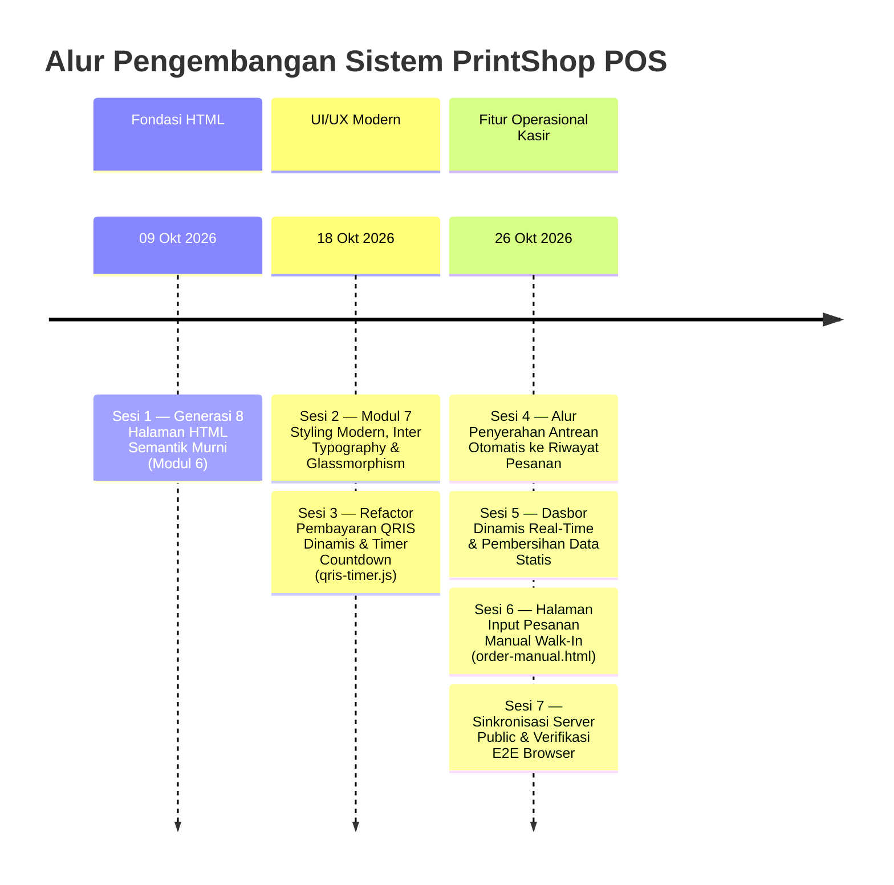

# Prompt Log — PrintShop POS Web Pages & System Development

| Item | Isi |
|---|---|
| **Proyek** | PrintShop POS (Sistem Kasir & Antrean Percetakan Digital) |
| **Versi** | 2.1.0 |
| **Terakhir Diperbarui** | 26 Oktober 2026, 13:00 WITA |
| **Dibuat & Dikelola oleh** | Tim Developer Antigravity — Divisi Web UI/UX & Fullstack |
| **Referensi Utama** | `PRD.md`, `DESIGN_SYSTEM.md`, Modul 6 (HTML Semantik), Modul 7 (CSS Modern & UI/UX), REST API & Store |

---

## 1. Ringkasan Riwayat Sesi (Session Overview)



---

## 2. Riwayat Detail Prompt & Log Perubahan

### Sesi 1 — Generasi Awal 8 Halaman HTML Semantik Murni
**Tanggal:** 09 Oktober 2026  
**Instruksi Pengguna:**
> *"Berdasarkan dokumen PRD dan aturan ketat dari Modul 6 yang saya lampirkan, tolong buatkan kode lengkap untuk 8 halaman web PrintShop POS beserta perbaikan sinkronisasi aset gambar dan tautan simulasinya."*

**Fokus Pengerjaan:**
- Implementasi 8 halaman HTML5 semantik (`index.html`, `unggah.html`, `spesifikasi.html`, `pembayaran.html`, `tiket.html`, `login.html`, `dasbor.html`, `antrean.html`).
- Kepatuhan Modul 6: Zero CSS, struktur semantik murni (`<header>`, `<nav>`, `<main>`, `<section>`, `<article>`, `<footer>`, `<figure>`, `<fieldset>`, `<legend>`).
- Penyusunan direktori aset gambar dan ikon SVG di `assets/images/`.

---

### Sesi 2 & 3 — Modul 7: Desain Antarmuka Modern & Pembayaran QRIS Dinamis
**Tanggal:** 18 Oktober 2026  
**Instruksi Pengguna:**
> *"Gunakan skill @ui-ux-pro-max dan @frontend-design. Lihat gaya desain dari @index.html dan @spesifikasi.html sebagai acuan visual. Tolong kerjakan halaman @pembayaran.html dan buatkan file logika @assets/js/qris-timer.js sesuai spesifikasi PRD Modul 7."*

**Perubahan & Implementasi:**
1. **Fidelitas Desain & Responsivitas (`pembayaran.html`):**
   - Penerapan sistem desain modern: Palet `#1D4ED8` (Royal Blue), `#059669` (Emerald Green), latar `#F8FAFC` dengan card glassmorphism.
   - Tata letak responsif dua kolom (Mobile `< 768px` hingga Desktop `> 1200px`).
   - Kartu rincian subtotal pesanan dinamis membaca data dari `sessionStorage` dengan fallback data yang rapi.
   - Visual kode QRIS dinamis di tengah panel dengan bingkai scan, nominal otomatis, dan tautan simpan gambar.
   - Polling status badge "Menunggu Pembayaran" (`PENDING_PAYMENT`) dengan animasi pulse halus.
2. **Logika Interaktif (`assets/js/qris-timer.js`):**
   - Countdown timer 5 menit (`05:00`) menghitung mundur real-time per detik.
   - Indikator visual progress bar yang menyusut mulus seiring berjalannya waktu.
   - State handling saat waktu habis (peringatan expired, nonaktifkan tombol, opsi generate ulang QR).
   - Modal simulasi pembayaran berhasil dan transisi otomatis menuju `tiket.html`.

---

### Sesi 4 — Pembaruan Modul Antrean: Alur Penyerahan ke Riwayat Pesanan
**Tanggal:** 26 Oktober 2026  
**Instruksi Pengguna:**
> *"update bagian antrean dan dasbor, buat agar saat data antrean sudah diserahkan langsung masuk ke riwayat pesanan..."*

**Masalah Sebelumnya:**
- Tabel riwayat pesanan (`#riwayat`) di `antrean.html` tidak pernah terisi otomatis karena `antrean.js` hanya menyeleksi tabel pertama (`.console-table tbody`) dan API hanya memfilter status antrean aktif.
- Saat pesanan berstatus *Siap Diambil* (`READY_FOR_PICKUP`) diserahkan, data tidak berpindah ke tabel riwayat.

**Perubahan & Implementasi:**
1. **Penetapan ID Tabel Semantik:**
   - Tabel Antrean Aktif: Diberi atribut `id="queue-table-tbody"` pada `<tbody>`.
   - Tabel Riwayat Pesanan: Diberi atribut `id="history-table-tbody"` pada `<tbody>`.
2. **Pemisahan Logika Dataset (`assets/js/antrean.js`):**
   - `activeOrders`: Memfilter status `WAITING_IN_QUEUE`, `PROCESSING`, `PRINTING`, `READY_FOR_PICKUP`.
   - `historyOrders`: Memfilter status `COMPLETED` dan `CANCELLED`.
3. **Mekanisme Transisi Tombol "Serahkan":**
   - Ketika operator mengklik tombol **"Serahkan"**, sistem memanggil `PrintShopAPI.updateOrderStatus(orderId, 'COMPLETED')`.
   - Pesanan langsung terhapus dari antrean aktif dan disuntikkan ke baris paling atas tabel riwayat pesanan dengan badge hijau **"Selesai"**.
   - Muncul notifikasi toast pop-up: *"Pesanan #ORD-xxx berhasil diserahkan dan dipindahkan ke Riwayat Pesanan."*
4. **Metrik & Fitur Riwayat Tambahan:**
   - Kartu ringkasan riwayat dihitung dinamis: Total Selesai, Omzet Tervalidasi, Lembar Tercetak, dan Avg Lead Time.
   - Modal Pratinjau Detail & Struk Riwayat: Operator dapat melihat spesifikasi lengkap dan mencetak ulang struk kasir kapan saja.
   - Auto-polling background setiap 3,5 detik.

---

### Sesi 5 — Dasbor Operator: 100% Dinamis & Pembersihan Data Statis
**Tanggal:** 26 Oktober 2026  
**Instruksi Pengguna:**
> *"...kemudian untuk dasbor buat agar selalu update dan hapus data statis yang ada..."*

**Masalah Sebelumnya:**
- `dasbor.html` dan `assets/js/dasbor.js` memuat angka hardcoded statis (contoh: Omzet Rp 842.500, Lembar 1.240, dll).
- Terdapat blok `<script>` inline lama (baris 854-959) yang menimpa fungsi ekspor CSV dengan string teks statis tahun 2026.
- Grafik batang 7 hari dan tabel kategori tidak sinkron dengan transaksi pesanan nyata.

**Perubahan & Implementasi:**
1. **Pembersihan Total Data Statis:**
   - Menghapus blok skrip inline lawas pembawa data statis di `dasbor.html`.
   - Mengganti seluruh teks statis di kartu KPI dengan target DOM ID: `kpi-omzet`, `kpi-antrean`, `kpi-lembar`, `kpi-transaksi`, `audit-lembar-count`.
2. **Perhitungan Real-time (`assets/js/dasbor.js`):**
   - Terhubung langsung ke `PrintShopAPI.getOrders()` dan `PrintShopAPI.getDashboardStats()`.
   - **4 KPI Utama**: Menghitung omzet riil hari ini (dengan split QRIS vs Tunai), jumlah antrean aktif, total lembar cetak tervalidasi, dan transaksi selesai.
   - **Grafik Batang 7 Hari Dinamis (`bar-chart-container`)**: Dihitung dari tanggal hari ini hingga 6 hari ke belakang, dengan skala bar proporsional, highlight hari ini, serta label legend perbandingan.
   - **Tabel Semantik 7 Hari (`chart-table-tbody` & `chart-table-tfoot`)**: Menampilkan rincian tanggal, omzet, transaksi, lembar cetak, dan rata-rata per transaksi dengan total footer yang akurat.
   - **Distribusi Kategori Layanan (`category-breakdown-list`)**: Menghitung persentase volume dan pendapatan per kategori cetak (Hitam-Putih, Warna, Folio/Khusus).
   - **Status Printer Real-time**: Menampilkan tugas aktif printer sesuai pesanan yang sedang berstatus `PRINTING`.
   - **Feed Transaksi Terbaru (`dashboard-recent-tbody`)**: Menampilkan 6 transaksi terakhir baik dari web-client maupun kasir walk-in.
   - **Ekspor CSV Dinamis**: Menghasilkan file CSV kasir langsung dari memori dataset riil saat tombol diklik.
   - Polling live otomatis setiap 4 detik.

---

### Sesi 6 — Fitur Tambah Pesanan Manual Kasir Walk-In (`order-manual.html`)
**Tanggal:** 26 Oktober 2026  
**Instruksi Pengguna:**
> *"...buatkan page add order manual untuk menambahkan pesanan tanpa menggunakan page client"*

**Solusi & Implementasi:**
1. **Halaman Khusus Kasir (`order-manual.html`):**
   - Layout 2 kolom khas POS kasir: Kolom kiri (Formulir Parameter Cetak & Finishing) dan Kolom kanan (Sticky Struk Rincian Biaya & Panel Pembayaran Tunai).
   - Aksesibilitas navigasi: Tautan "Tambah Pesanan Walk-In" disematkan di header dan sidebar `dasbor.html`, `antrean.html`, dan `order-manual.html`.
2. **Formulir Input Spesifikasi Lengkap:**
   - Data Pelanggan: Nama lengkap & nomor WhatsApp aktif (notifikasi tiket).
   - Dokumen: Nama file cetak, jumlah halaman per eksemplar, dan jumlah eksemplar/copy.
   - Parameter Kertas: Ukuran (A4, F4 / Folio, A3), Mode Warna (B/W, Spot Color, Full Color), Sisi (1 Sisi / 2 Sisi Bolak-balik), Jenis Kertas (HVS 70gr, HVS 80gr, Art Paper 150gr, Concorde).
   - Finishing & Jilid: Tanpa Jilid, Steples Sudut (+Rp 2.000), Jilid Lakban Hitam (+Rp 5.000), Spiral Kawat (+Rp 12.000), Hard Cover Skripsi (+Rp 35.000).
   - Catatan Khusus untuk operator mesin cetak.
3. **Kalkulator & Kasir Tunai Dinamis (`assets/js/order-manual.js`):**
   - Matriks harga cetak otomatis menghitung total lembar dan subtotal biaya cetak + biaya jilid.
   - Kalkulator uang tunai: Tombol shortcut uang cepat (`+Rp 10.000`, `+Rp 20.000`, `+Rp 50.000`, `+Rp 100.000`, `Uang Pas`).
   - Kalkulasi otomatis uang kembalian atau peringatan jika nominal pembayaran kurang.
4. **Integrasi Antrean Langsung:**
   - Menyimpan pesanan ke database/store via `PrintShopAPI.createOrder()`.
   - Menerbitkan nomor tiket resmi (misal: `#ORD-600`) dengan metode `CASH` dan status `PAID`.
   - Menampilkan modal pop-up struk kasir dengan tombol cetak struk atau langsung loncat ke antrean cetak.

---

### Sesi 7 — Sinkronisasi Server Publik & Verifikasi End-to-End Browser
**Tanggal:** 26 Oktober 2026  
**Aktivitas & Temuan:**
1. **Penyelarasan Direktori `public/`:**
   - Ditemukan bahwa Next.js server menyajikan file statis dari folder `public/`.
   - File yang diperbarui di root repo disinkronkan ke `public/` (`order-manual.html`, `antrean.html`, `dasbor.html`, `pembayaran.html`, dan skrip JS terkait).
2. **Pengujian Otomatis via Browser Subagent:**
   - **Langkah 1**: Login via `http://localhost:3000/login.html` (Operator: `operator@printshop.com` / `123456`). Berhasil masuk ke sistem konsol.
   - **Langkah 2**: Buka `http://localhost:3000/order-manual.html`. Input pesanan pelanggan "Budi Santoso", file "Laporan_Magang_Budi.pdf", 15 halaman Folio, Jilid Steples Sudut, bayar tunai Rp50.000. Tiket `#ORD-600` berhasil diterbitkan.
   - **Langkah 3**: Buka `http://localhost:3000/antrean.html`. Pesanan `#ORD-600` muncul di baris antrean aktif.
   - **Langkah 4**: Siklus transisi status dijalankan: *Mulai Cetak* $\rightarrow$ *Siap Ambil* $\rightarrow$ *Serahkan*.
   - **Hasil Verifikasi**: Pesanan `#ORD-600` seketika hilang dari antrean aktif dan muncul di tabel **Riwayat Pesanan** dengan badge hijau **"Selesai"** beserta rekaman omzet.
   - **Langkah 5**: Buka `http://localhost:3000/dasbor.html`. Seluruh metrik KPI (Omzet, Antrean, Lembar Cetak, Transaksi Selesai), grafik 7 hari, dan transaksi terbaru ter-update secara dinamis tanpa data statis.

---

## 3. Matriks Inventaris File Proyek (Status Terkini)

| File | Tipe | Lokasi | Deskripsi & Peran |
|---|---|---|---|
| `index.html` | HTML5 | Root & `public/` | Landing page publik mahasiswa |
| `unggah.html` | HTML5 | Root & `public/` | Halaman unggah berkas cetak |
| `spesifikasi.html` | HTML5 | Root & `public/` | Konfigurasi spesifikasi kertas & kalkulator estimasi |
| `pembayaran.html` | HTML5 | Root & `public/` | Pembayaran QRIS dinamis + countdown timer |
| `tiket.html` | HTML5 | Root & `public/` | Tracking status tiket pesanan & kode klaim |
| `login.html` | HTML5 | Root & `public/` | Autentikasi sesi operator percetakan |
| `dasbor.html` | HTML5 | Root & `public/` | Dasbor KPI, grafik 7 hari & laporan operasional dinamis |
| `antrean.html` | HTML5 | Root & `public/` | Manajemen antrean cetak FIFO & riwayat pesanan selesai |
| `order-manual.html` | HTML5 | Root & `public/` | **[BARU]** POS kasir tambah pesanan walk-in mandiri |
| `assets/js/antrean.js` | JS | Root & `public/` | **[UPDATE]** Logika status antrean, mutasi serah riwayat & modal struk |
| `assets/js/dasbor.js` | JS | Root & `public/` | **[UPDATE]** Perhitungan metrik KPI, render chart 7 hari & ekspor CSV |
| `assets/js/order-manual.js` | JS | Root & `public/` | **[BARU]** Kalkulator tarif cetak, hitung kembalian tunai & submit order |
| `assets/js/qris-timer.js` | JS | Root & `public/` | **[UPDATE]** Countdown 5 menit, progress bar & simulasi verifikasi QRIS |
| `assets/js/api.js` | JS | Root & `public/` | API client wrapper untuk sinkronisasi pesanan & dasbor |
| `assets/css/global.css` | CSS | Root & `public/` | Design system tokens, Inter typography, palet `#1D4ED8` & utilitas |
| `prompt-log.md` | Markdown | Root & `public/` | **[UPDATE]** Log komprehensif seluruh prompt, arsitektur & perubahan |

---

## 4. Panduan Menjalankan & Verifikasi Sistem

1. **Menjalankan Dev Server:**
   ```bash
   npm run dev
   ```
   Aplikasi akan aktif di `http://localhost:3000`.

2. **Kredensial Login Operator:**
   - **URL:** `http://localhost:3000/login.html`
   - **Email:** `operator@printshop.com`
   - **PIN:** `123456`

3. **Alur Singkat Pengujian Kasir:**
   - Kunjungi `order-manual.html` $\rightarrow$ Masukkan pesanan $\rightarrow$ Klik *Simpan Pesanan*.
   - Kunjungi `antrean.html` $\rightarrow$ Klik *Mulai Cetak* $\rightarrow$ Klik *Siap Ambil* $\rightarrow$ Klik *Serahkan*.
   - Gulir ke bawah pada `antrean.html` untuk memverifikasi pesanan masuk ke tabel *Riwayat Pesanan*.
   - Kunjungi `dasbor.html` untuk melihat statistik pendapatan, lembar cetak, dan grafik yang ter-update otomatis.

---
*Dokumen ini diperbarui secara berkala sebagai catatan jejak rekayasa perangkat lunak sistem PrintShop POS.*
